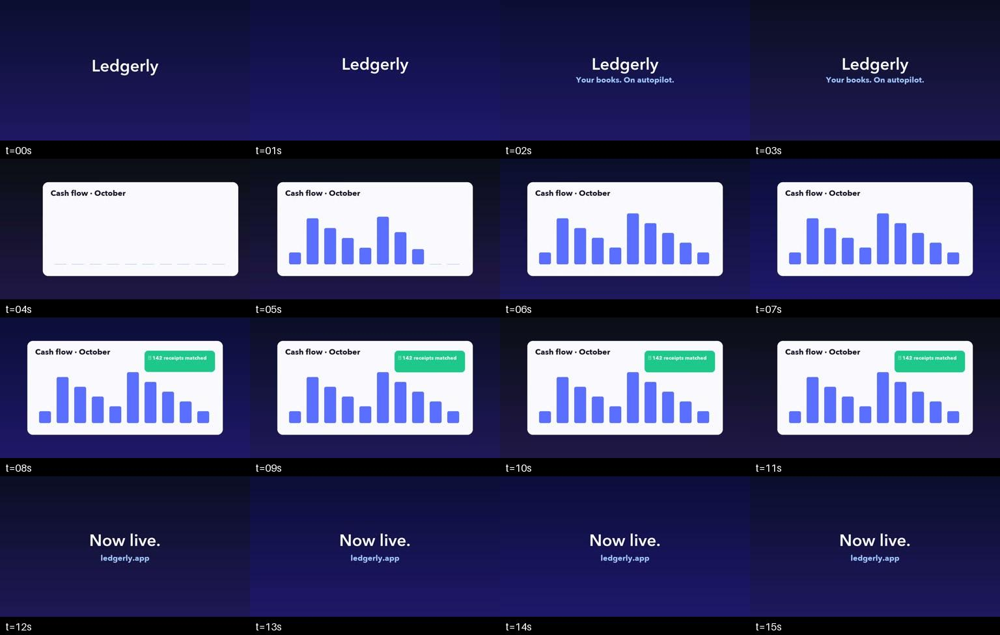

<div align="center">

# 🐕 LaunchHound

**Sniffs out polished product-launch videos on X, so you don't have to scroll for hours.**

Point it at a video (or a whole X account), and it tells you whether the clip is a genuinely
good SaaS/product launch video, with a category, a quality grade, and timestamped evidence.


<sub>Full-quality demo: [`docs/launchhound-demo.mp4`](docs/launchhound-demo.mp4)</sub>

</div>

---

## Why I built this

I wanted a swipe file of *really* good SaaS launch videos: the slick motion-design ones, not
podcasts or someone talking to a webcam. Most of them live on X, buried between memes and
founder updates. Finding them by hand took forever, so I taught a script to do the scrolling
and judging for me.

**First real run:** 300 videos from 16 creators. **167 kept, 133 tossed.** Most of the rejects were talking
heads, plain screen recordings, or so-so production quality.

## How it works

```
 X account ──► download videos ──► 1 frame / sec ──► contact sheets ──► GPT-4o-mini ──► validated JSON
 (twscrape)     (best-bitrate MP4)    (ffmpeg)        (4×4, timestamped)  (Batch API)    (Pydantic schema)
```

1. **Fetch.** Pulls video posts from X accounts, skips reposts, de-dupes, and grabs the highest-bitrate MP4.
2. **Sample.** ffmpeg takes one frame per second.
3. **Pack.** Frames are tiled into timestamped 4×4 contact sheets, so a 16-second clip becomes
   one image instead of 16 separate image inputs (cheaper, and the model sees the whole timeline).
4. **Judge.** All sheets go to OpenAI in a single Batch request, using a strict curator prompt.
5. **Validate.** The response is checked against a Pydantic schema with consistency rules
   (for example, a clip can't be "eligible" if it contains a talking head).
6. **Organize.** Accepted videos are copied to `data/output/useful-videos/`.

Here's a real contact sheet LaunchHound generated from a 16-second sample clip:



## What counts as a launch video

✅ **Kept** if the video:

- visibly announces, reveals, or showcases a product or major feature;
- uses polished product/software motion, not a plain screen recording;
- has **no** founder, presenter, interview, podcast, or talking-head footage, not even briefly; and
- has `good` or `premium` production quality.

❌ **Tossed:** founder updates, podcasts, tutorials, memes, basic screen recordings, unrelated
cinematic clips, and anything ambiguous. Every reject comes with reasons and timestamped evidence.

> It's visual-only. Launch claims that are only *spoken* and never shown on screen may be missed.

## Quick start

**You'll need:** Python 3.11+, `ffmpeg`/`ffprobe` (`brew install ffmpeg` on macOS), and an OpenAI API key with billing enabled.

```bash
git clone https://github.com/ritiksharma33/launchhound.git
cd launchhound
python3 -m venv .venv && source .venv/bin/activate
pip install -e ".[dev]"
cp .env.example .env        # then put your OPENAI_API_KEY in .env
```

### Classify one video

```bash
# Free: extracts frames and builds the request locally, no API call
launchhound prepare /path/to/video.mp4

# Then submit, check, and collect using the job_id it prints
launchhound submit <job_id>
launchhound status <job_id>
launchhound collect <job_id>

# Or do all of it in one go
launchhound run /path/to/video.mp4
```

### Classify a bunch at once

```bash
launchhound prepare-many a.mp4 b.mp4 c.mp4
launchhound submit <job_id>
launchhound wait-collect <job_id>   # polls until done, then saves results.json
```

### Scan an X account

```bash
launchhound x-add-cookie x-test                       # hidden prompt, see the note below
launchhound x-fetch varcyyyy --post-limit 100 --max-videos 100
launchhound run-manifest .launch-classifier/x-media/varcyyyy/manifest.json
```

Need results now instead of waiting on Batch? Use the synchronous runner:

```bash
launchhound run-manifest-fast manifest1.json manifest2.json --concurrency 3
```

> `launch-classifier` still works as an alias for `launchhound`.

## Example output

A real result from the first run (evidence trimmed to one entry):

```json
{
  "filename": "2108489019143360666_0.mp4",
  "is_launch_video": true,
  "launch_confidence": 0.95,
  "is_saas_motion": true,
  "contains_talking_head": false,
  "contains_multi_video_showcase": false,
  "eligible_for_collection": true,
  "category": "ai",
  "subcategory": "code generation",
  "visual_style": "product_motion",
  "production_quality": "premium",
  "summary": "A premium launch video for Blackbox AI, showcasing code generation features with polished motion design.",
  "evidence_timestamps": [
    { "timestamp_seconds": 13, "observation": "Text 'Turn questions into production-ready code', indicating feature capability." }
  ],
  "rejection_reasons": []
}
```

Categories: `fintech`, `ai`, `developer_tools`, `productivity`, `design`, `marketing`,
`ecommerce`, `education`, `healthcare`, `other`.

## All commands

| Command | What it does |
| --- | --- |
| `prepare <video>` | Extract frames and build the Batch request (no API cost) |
| `prepare-many <videos…>` | One Batch job for several videos |
| `prepare-manifest <manifest>` | One Batch job from an X manifest |
| `submit` / `status` / `collect <job>` | Step through a Batch job manually |
| `run <video>` | Prepare, submit, wait, and collect one video |
| `run-manifest <manifest>` | Same thing for every video in an X manifest |
| `run-manifest-fast <manifests…>` | Synchronous analysis with limited concurrency |
| `wait-collect <job>` | Poll a submitted job and save the result |
| `merge-results <out> <inputs…>` | Merge result files and de-dupe by video |
| `accepted-results <in> <out>` | Keep only collection-eligible entries |
| `restore-useful-videos <results>` | Re-copy accepted videos into the output folder |
| `x-add-cookie` / `x-accounts` | Manage local X sessions |
| `x-fetch <handle>` | Download recent video posts from one account |
| `x-fetch-founders <founders.json>` | Fetch from a list of accounts, one after another |
| `x-media-status` / `x-clear-videos` | Check or free up downloaded media |
| `cleanup <jobs…>` | Remove temporary job artifacts |

## Configuration

All settings live in `.env` (see [`.env.example`](.env.example)):

| Variable | Default | Notes |
| --- | --- | --- |
| `OPENAI_API_KEY` | – | Required for submitting |
| `OPENAI_MODEL` | `gpt-4o-mini` | Must support image input, Responses, Batch, and Structured Outputs |
| `CLASSIFIER_WORK_DIR` | `.launch-classifier` | Jobs, manifests, downloaded media |
| `USEFUL_VIDEO_DIR` | `data/output/useful-videos` | Where accepted videos land |
| `MAX_VIDEO_SECONDS` | `600` | Longer videos are refused |
| `MAX_BATCH_JSONL_MB` | `190` | Safety limit. Payloads are refused, never silently trimmed |

Temporary frames and sheets are cleaned up automatically once they're no longer needed.

## A note on scraping X

The X fetcher uses [`twscrape`](https://github.com/vladkens/twscrape), which talks to X's
internal endpoints. It can break, get rate-limited, or get the account locked. **Use a
dedicated test account**, never your main one, and review X's terms first. Import cookies
(`auth_token` and `ct0` only) through the hidden prompt. Never paste them into source files or
shell history. For anything serious, the official X API is the safer route.

## Development

```bash
pytest              # 19 tests
ruff check .
ruff format --check .
```

## Project layout

```
src/twitter_scrapper/
├── cli.py        # command-line entry point
├── video.py      # ffmpeg sampling + contact sheets
├── batch.py      # OpenAI Batch prepare/submit/collect
├── prompt.py     # the curator prompt
├── schema.py     # Pydantic result schema + consistency rules
├── x_ingest.py   # X fetching via twscrape
└── config.py     # .env-driven settings
```

---

<div align="center">
Built by <a href="https://github.com/ritiksharma33">Ritik Sharma</a>. If it saves you some scrolling, a ⭐ is appreciated.
</div>
